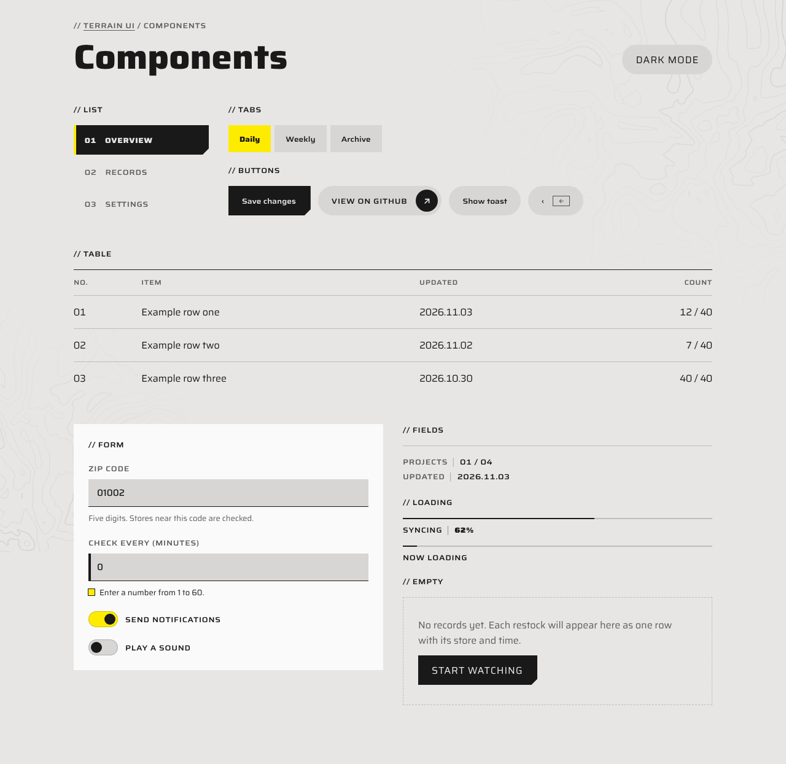
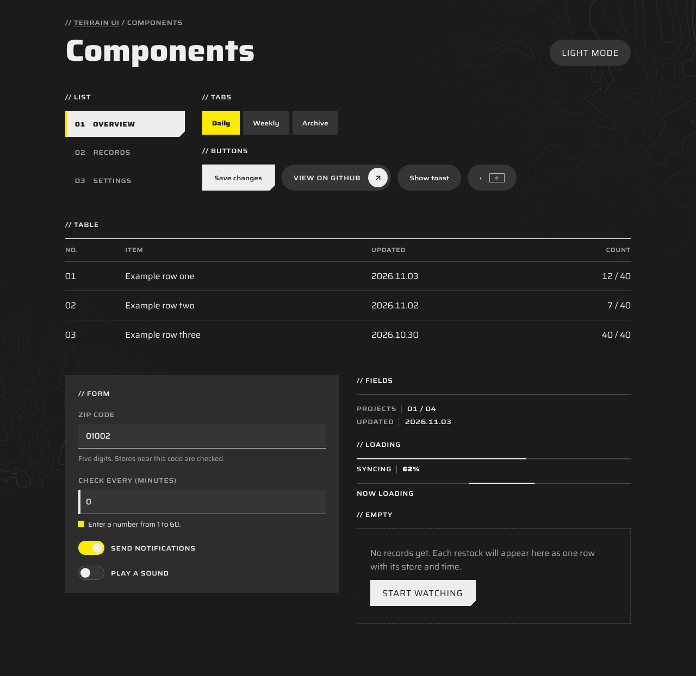
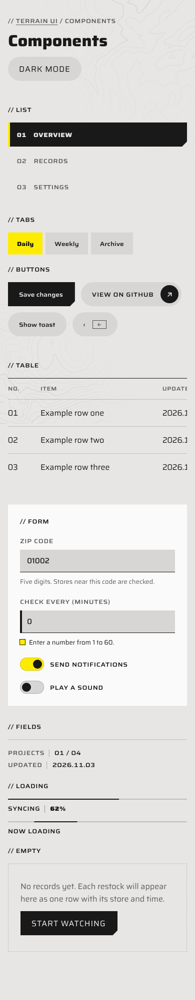
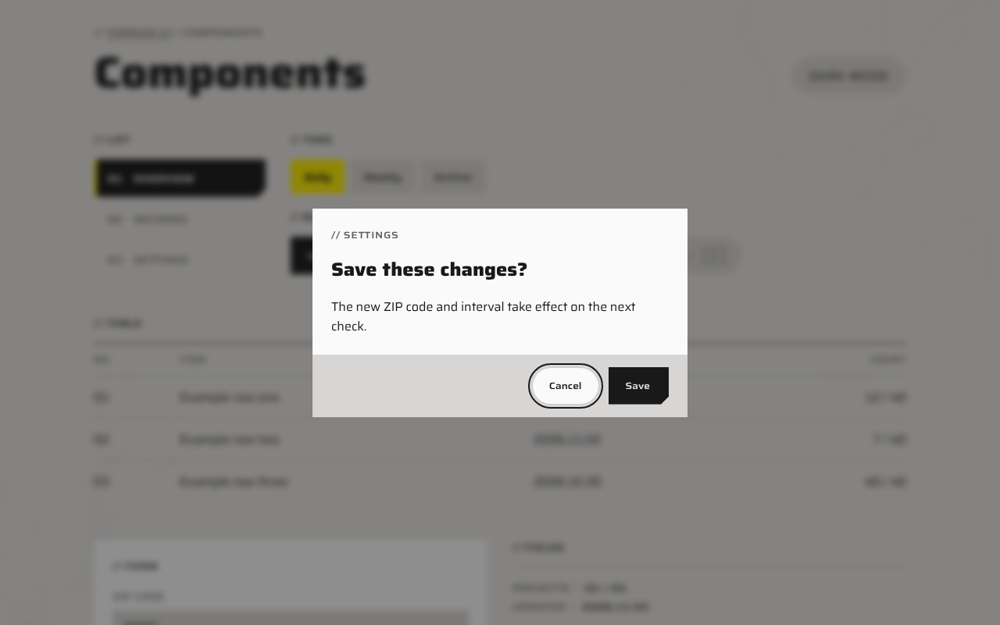

# terrain-ui

An agent skill for building web pages in a quiet industrial style inspired by the interface of *Arknights: Endfield*: paper and ink, one accent color that only marks "current" and "primary", selection states that read at a glance, pill-shaped secondary buttons, `//` path titles, and faint closed contour lines in the background.

The rules were distilled from studying the game's in-game menus frame by frame and its official website, then kept only if they held up on a real website. See `references/research.md` for what was observed, measured, kept and dropped.

## Screenshots

| Components, light | Components, dark |
| --- | --- |
|  |  |

| Phone width | Dialog |
| --- | --- |
|  |  |

## Page types

Pick one before building. **Reading** (articles, project details, settings): one column, quiet. **Showcase** (home, portfolio, landing): large wide type, contours on. **Workbench** (dashboards, tools, extension settings): list navigation, tabs, tables, forms, no large titles.

## Contents

```
terrain-ui/
├── SKILL.md                 rules, motion table, checklist (the agent reads this first)
├── assets/terrain.css       color tokens (light and dark) and components, prefix tu-
├── assets/contours.js       contour background: TerrainContours.mount(canvas)
├── examples/demo.html       every component on one page
├── examples/screenshots/    light, dark, phone and dialog
└── references/research.md   research notes with evidence labels
```

## Install

Claude Code: copy this folder to `~/.claude/skills/terrain-ui/`, or to `<project>/.claude/skills/terrain-ui/` for one project.

Other agents: put the folder in your project and tell the agent to read `SKILL.md` before building UI.

## Preview

Open `examples/demo.html` through a local server from the repository root, for example `python3 -m http.server 8000`, then visit `http://localhost:8000/examples/demo.html`.

## Credits

This skill was written from scratch; no files were copied from other projects. It does build on [hhikr/endfield-ui-skill](https://github.com/hhikr/endfield-ui-skill), which was used on an earlier version of the test site. Ideas that came from there:

- Saira as the wide Latin face
- The primary button shape: a block with one 10 px cut corner, filled by an accent wipe on hover
- Labeling research findings by evidence (measured / seen / guessed)

Colors, motion timings, the curve, selection states, button hierarchy, page types, the contour generator and all components were measured or designed for this project; see `references/research.md`.

## License

MIT. See `LICENSE`. The fonts keep their own license (SIL Open Font License).

## Notes

Unofficial fan project. Not affiliated with or endorsed by Hypergryph, Gryphline or *Arknights: Endfield*, and contains no game assets. Game names belong to their respective owners. Fonts: Saira and Noto Sans SC, both under the SIL Open Font License, loaded from Google Fonts.
